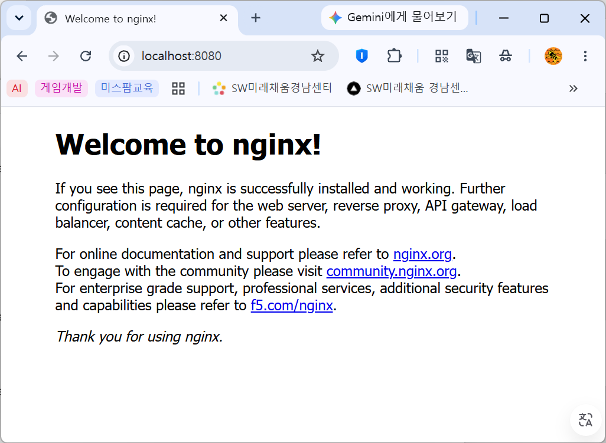
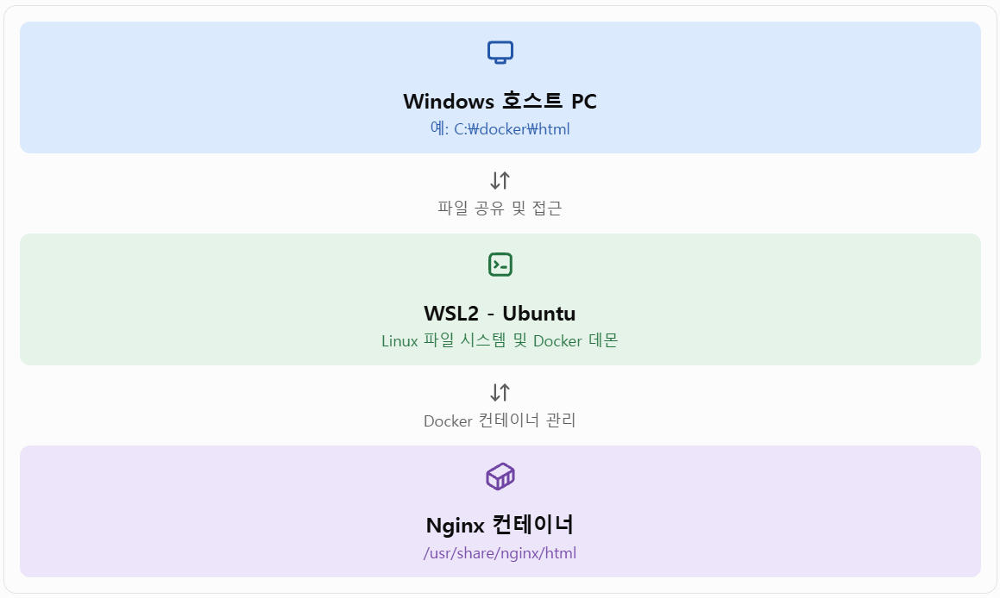
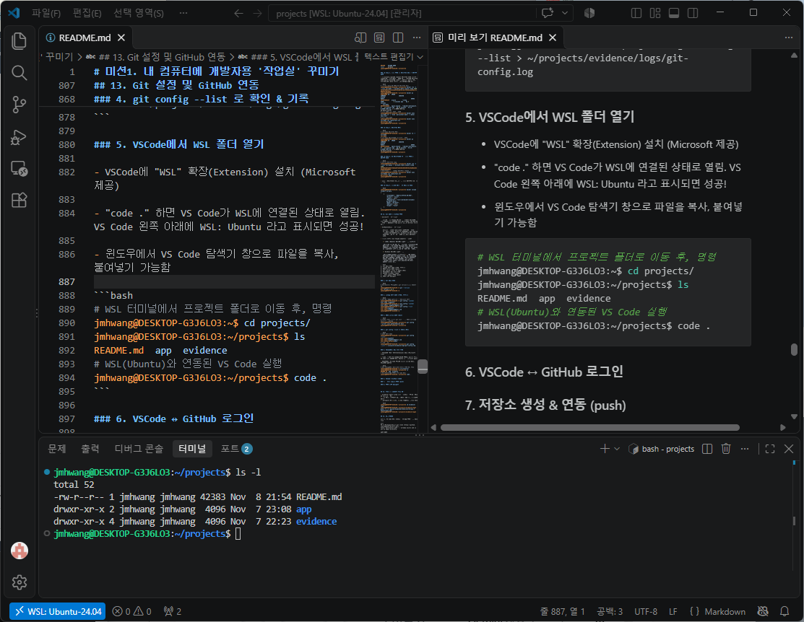
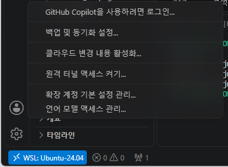
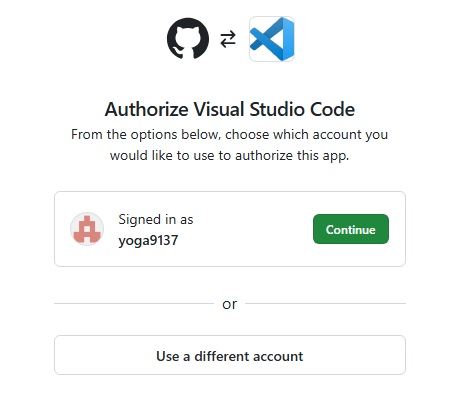
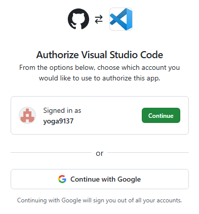
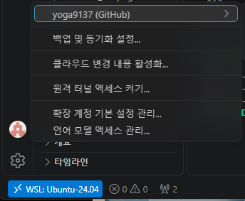
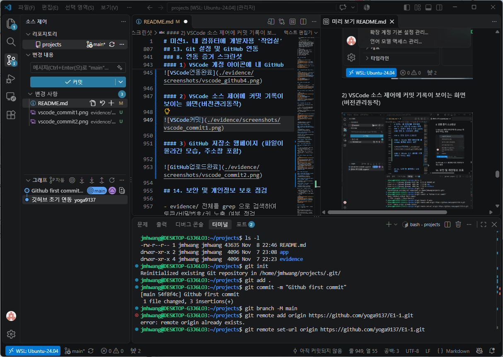
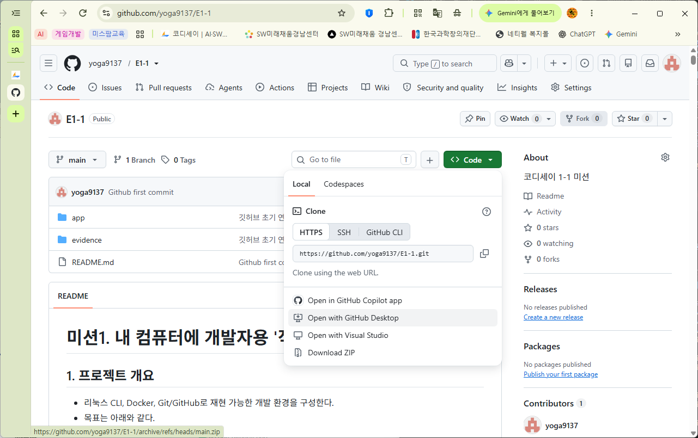

# 미션1. 내 컴퓨터에 개발자용 '작업실' 꾸미기

## 1. 프로젝트 개요

- 리눅스 CLI, Docker, Git/GitHub로 재현 가능한 개발 환경을 구성한다.
- 목표는 아래와 같다.
- 터미널을 이용한 작업 디렉토리 구성
- Docker 설치 및 동작 확인
- Dockerfile 기반 웹 서버 컨테이너 실행
- 포트 매핑을 통한 브라우저 접속 확인
- 바인드 마운트를 통한 변경 반영 확인
- Docker 볼륨을 통한 데이터 영속성 확인
- Git/GitHub/VSCode 연동 확인

## 2. 실행 환경

- OS: Windows / Ubuntu  
- Shell: PowerShell / 리눅스 CLI (bash)
- Terminal: VSCode Terminal / Windows Terminal / Terminal
- Docker: Docker version 29.9.2, build a82e528
- Git: git version 2.56.0.windows.4  
- VSCode: 1.144.1 (261c84cb1eddf11235f9e2c921425e9663fbe556, x64).  

## 3. 수행 항목 체크리스트

- [x] 터미널로 기본 조작 및 폴더 구성
- [x] 권한 변경 실습
- [x] Docker 설치 확인
- [x] Docker 기본 명령 실행
- [x] Dockerfile 작성
- [x] Docker 이미지 빌드
- [x] 컨테이너 실행
- [x] 포트 매핑 접속 확인
- [ ] 바인드 마운트 변경 반영 확인
- [ ] Docker 볼륨 영속성 확인
- [ ] Git 설정
- [ ] GitHub 저장소 생성 및 push
- [ ] VSCode GitHub 연동 확인

## 4. 터미널 기본 조작 로그

### [0] 작업 폴더 구성

```text
projects/
├─ app/
├─ evidence/
│  ├─ screenshots/
│  └─ logs/
└─ README.md
```

### [1] 폴더 이동

```bash
hcv70714678@GNIA-C202-A02:~$ cd projects     # 또는 cd projects/
hcv70714678@GNIA-C202-A02:~/projects$
```

### [2] 현재 폴더 위치 확인

pwd

```bash
$ pwd
/home/hcv70714678/projects
```

### [3] 숨김 파일까지 목록 확인

```bash
hcv70714678@GNIA-C202-A02:~/projects$ ls -al
total 20
drwxr-xr-x 5 hcv70714678 hcv70714678 4096 Nov  4 20:11 .
drwxr-x--- 5 hcv70714678 hcv70714678 4096 Nov  4 20:11 ..
drwxr-xr-x 7 hcv70714678 hcv70714678 4096 Nov  4 20:13 .git
-rw-r--r-- 1 hcv70714678 hcv70714678    0 Nov  4 20:11 README.md
drwxr-xr-x 2 hcv70714678 hcv70714678 4096 Nov  4 16:39 app
drwxr-xr-x 4 hcv70714678 hcv70714678 4096 Nov  4 17:15 evidence
hcv70714678@GNIA-C202-A02:~/projects$ ls -l
total 8
-rw-r--r-- 1 hcv70714678 hcv70714678    0 Nov  4 20:11 README.md
drwxr-xr-x 2 hcv70714678 hcv70714678 4096 Nov  4 16:39 app
drwxr-xr-x 4 hcv70714678 hcv70714678 4096 Nov  4 17:15 evidence
```

### [4] 빈 파일 생성

```bash
hcv70714678@GNIA-C202-A02:~/projects$ touch hello.txt
```

### [5] 내용 쓰고 확인

```bash
hcv70714678@GNIA-C202-A02:~/projects$ echo "Hello Test" > hello.txt
hcv70714678@GNIA-C202-A02:~/projects$ cat hello.txt
Hello Test
```

### [6] 복사

```bash
hcv70714678@GNIA-C202-A02:~/projects$ cp hello.txt copy.txt
```

### [7] 이름 변경

```bash
hcv70714678@GNIA-C202-A02:~/projects$ mv copy.txt renamed.txt
```

### [8] 변경된 목록 확인

```bash
hcv70714678@GNIA-C202-A02:~/projects$ ls -l
total 16
-rw-r--r-- 1 hcv70714678 hcv70714678    0 Nov  4 20:11 README.md
drwxr-xr-x 2 hcv70714678 hcv70714678 4096 Nov  4 16:39 app
drwxr-xr-x 4 hcv70714678 hcv70714678 4096 Nov  4 17:15 evidence
-rw-r--r-- 1 hcv70714678 hcv70714678   11 Nov  4 20:20 hello.txt
-rw-r--r-- 1 hcv70714678 hcv70714678   11 Nov  4 20:23 renamed.txt
```

### [9] 삭제

```bash
hcv70714678@GNIA-C202-A02:~/projects$ rm renamed.txt
```

### [10] 최종 목록 확인

```bash
hcv70714678@GNIA-C202-A02:~/projects$ ls -al
total 24
drwxr-xr-x 5 hcv70714678 hcv70714678 4096 Nov  4 20:24 .
drwxr-x--- 5 hcv70714678 hcv70714678 4096 Nov  4 20:11 ..
drwxr-xr-x 7 hcv70714678 hcv70714678 4096 Nov  4 20:13 .git
-rw-r--r-- 1 hcv70714678 hcv70714678    0 Nov  4 20:11 README.md
drwxr-xr-x 2 hcv70714678 hcv70714678 4096 Nov  4 16:39 app
drwxr-xr-x 4 hcv70714678 hcv70714678 4096 Nov  4 17:15 evidence
-rw-r--r-- 1 hcv70714678 hcv70714678   11 Nov  4 20:20 hello.txt
```

## 5. 권한 변경 실습 로그

### [1] 현재 권한 확인 (hello.txt 파일)

```bash
hcv70714678@GNIA-C202-A02:~/projects$ ls -l
total 12
-rw-r--r-- 1 hcv70714678 hcv70714678    0 Nov  4 20:11 README.md
drwxr-xr-x 2 hcv70714678 hcv70714678 4096 Nov  4 16:39 app
drwxr-xr-x 4 hcv70714678 hcv70714678 4096 Nov  4 17:15 evidence
-rwxrwxrwx 1 hcv70714678 hcv70714678   11 Nov  4 20:20 hello.txt
```

### [2] 권한 변경(예: 소유자만 읽기/쓰기, 그룹/기타는 읽기 전용 -> 644)

```bash
hcv70714678@GNIA-C202-A02:~/projects$ chmod 644 hello.txt
hcv70714678@GNIA-C202-A02:~/projects$ ls -l
total 12
-rw-r--r-- 1 hcv70714678 hcv70714678    0 Nov  4 20:11 README.md
drwxr-xr-x 2 hcv70714678 hcv70714678 4096 Nov  4 16:39 app
drwxr-xr-x 4 hcv70714678 hcv70714678 4096 Nov  4 17:15 evidence
-rw-r--r-- 1 hcv70714678 hcv70714678   11 Nov  4 20:20 hello.txt
```

### [3] 디렉토리 권한 변경 실험 (예: 644)

```bash
# 디렉토리 생성
hcv70714678@GNIA-C202-A02:~/projects$ mkdir test_dir
hcv70714678@GNIA-C202-A02:~/projects$ ls -l
total 16
-rw-r--r-- 1 hcv70714678 hcv70714678    0 Nov  4 20:11 README.md
drwxr-xr-x 2 hcv70714678 hcv70714678 4096 Nov  4 16:39 app
drwxr-xr-x 4 hcv70714678 hcv70714678 4096 Nov  4 17:15 evidence
-rw-r--r-- 1 hcv70714678 hcv70714678   11 Nov  4 20:20 hello.txt
drwxr-xr-x 2 hcv70714678 hcv70714678 4096 Nov  4 20:42 test_dir
# 디렉토리 권한변경
hcv70714678@GNIA-C202-A02:~/projects$ chmod 644 test_dir/
hcv70714678@GNIA-C202-A02:~/projects$ ls -ld test_dir/
drw-r--r-- 2 hcv70714678 hcv70714678 4096 Nov  4 20:42 test_dir/
```

## 6. Docker 설치 및 기본 점검

### \- Docker 기본 명령어

| 명령어 | 설명 |
| ---------------------- | ---------------------- |
| `docker run -d 이미지명` | 새로운 컨테이너 생성 및 백그라운드 실행 |
| `docker start 컨테이너명` | 중지된 기존 컨테이너 다시 시작 |
| `docker stop 컨테이너명` | 실행 중인 컨테이너 중지 |
| `docker restart 컨테이너명` | 컨테이너 재시작 |
| `docker rm 컨테이너명` | 컨테이너 삭제 |
| `docker logs 컨테이너명` | 컨테이너 로그 확인 |

### [1] Docker Desktop 설치

- [Docker 공식 홈페이지](https://www.docker.com/products/docker-desktop/)에서 **Docker Desktop for Windows**를 다운로드하여 설치
- 설치 중 **"Use WSL 2 instead of Hyper-V"** 옵션을 반드시 체크

### [2] 설정 확인(WSL 통합)

1) Docker Desktop 앱 실행 ➔ 상단 톱니바퀴(Settings) ➔ **General**에서 _"Choose Virtual Machine Manager (VMM) → WSL 2"_ 선택 확인

2) 기본 WSL 배포판 통합 켜기

- **WSL Integration**에서 ➔ "Enable integration with my default WSL distro → 켬" `Ubuntu` 배포판과의 통합 스위치가 켜져 있는지 확인

3) Ubuntu 배포판 선택하기

- **WSL Integration**에서 ➔ "Enable integration with additional distros"에서 Ubuntu 선택하고, 아래의 Apply & Restart Engine 버튼을 클릭

### [3] Ubuntu 연동 점검

Ubuntu 터미널을 열고 다음 명령어를 실행

```bash
hcv70714678@GNIA-C202-A02:~/projects$ docker --version
Docker version 29.9.2, build a82e528
```

```bash
hcv70714678@GNIA-C202-A02:~/projects$ docker run hello-world
permission denied while trying to connect to the docker API at unix:///var/run/docker.sock
```

현재 오류는 Docker 엔진이 실행되지 않는 문제가 아니라, Ubuntu 사용자가 Docker 소켓(`/var/run/docker.sock`)에 접근할 권한이 없는 문제임.
따라서 관리자 권한으로 다시 실행하거나, chmod 명령어를 이용해서 docker.sock 파일 접근 권한을 변경한 후, 다시 실행하면 됨.

```bash
hcv70714678@GNIA-C202-A02:~/projects$ sudo docker run hello-world
```

### [4] Ubuntu 에서 Docker 기본 점검

```bash
# 버전 확인
hcv70714678@GNIA-C202-A02:~/projects$ sudo docker --version
Docker version 29.9.2, build a82e528

# 데몬 동작 확인
hcv70714678@GNIA-C202-A02:~/projects$ sudo docker info
Client:
 Version:    29.9.2
 Context:    default
 Debug Mode: false
 ...
Server:
 Containers: 1
  Running: 0
  Paused: 0
  Stopped: 1
 Images: 1
 ... 

# hello-world 컨테이너 구동 테스트
hcv70714678@GNIA-C202-A02:~/projects$ sudo docker run hello-world

Hello from Docker!
This message shows that your installation appears to be working correctly.

To generate this message, Docker took the following steps:
 1. The Docker client contacted the Docker daemon.
 2. The Docker daemon pulled the "hello-world" image from the Docker Hub.
    (amd64)
 3. The Docker daemon created a new container from that image which runs the
    executable that produces the output you are currently reading.
 4. The Docker daemon streamed that output to the Docker client, which sent it
    to your terminal.

To try something more ambitious, you can run an Ubuntu container with:
 $ docker run -it ubuntu bash

Share images, automate workflows, and more with a free Docker ID:
 https://hub.docker.com/

For more examples and ideas, visit:
 https://docs.docker.com/get-started/
```

## 7. Docker 기본 운영 명령

### [1] 이미지 관련 명령 (다운로드 및 목록 확인)

Docker 이미지를 원격 저장소(Docker Hub)에서 다운로드하고 로컬에 저장된 목록을 확인

\- 이미지 다운로드 (Nginx 가벼운 웹 서버 이미지를 로컬에 다운로드)

```bash
hcv70714678@GNIA-C202-A02:~/projects$ sudo docker pull nginx:alpine
alpine: Pulling from library/nginx
657023555a2a: Pull complete
b9b388a21ecf: Pull complete
7cc330898115: Pull complete
26185d08a3ec: Pull complete
2ec5fb117ffa: Pull complete
7b229517ed22: Pull complete
12b85cff06fd: Pull complete
9b0f7dfe35b2: Pull complete
a4d5b1f57abc: Download complete
acc2d54c3743: Download complete
Digest: sha256:785835ea65db4bba6f021acc0f3be91b0fef76a53fe41f8588c6698d2aed0606
Status: Downloaded newer image for nginx:alpine
docker.io/library/nginx:alpine
```

\- 로컬 이미지 목록 확인 (방금 다운로드한 `nginx`를 포함해 시스템에 저장된 모든 이미지의 목록, 태그, 이미지 ID, 크기가 표시)

```bash
hcv70714678@GNIA-C202-A02:~/projects$ sudo docker images
                                                                                                    i Info →   U  In Use
IMAGE                ID             DISK USAGE   CONTENT SIZE   EXTRA
hello-world:latest   c567b231f656       25.9kB         9.49kB    U
nginx:alpine         785835ea65db       94.5MB         27.2MB
ubuntu:latest        6a06111c3b0a        163MB         45.9MB    U
hcv70714678@GNIA-C202-A02:~/projects$
```

### [2] 컨테이너 관련 명령 (실행, 중지, 목록 확인)

다운로드한 이미지를 기반으로 컨테이너를 생성·실행하고, 상태를 관리

\- 컨테이너 실행

```bash
hcv70714678@GNIA-C202-A02:~/projects$ sudo docker run -d --name my-nginx-container -p 8080:80 nginx:alpine
a8286d2b8c850a0fccfaf38284b40c7a92b9bd7b65040176695324080f765143
hcv70714678@GNIA-C202-A02:~/projects$
```

- `-d`: 백그라운드(Detached 모드)에서 실행
- `--name my-nginx-container`: 컨테이너 이름을 지정
- `-p 8080:80`: **호스트의 8080 포트**를 **컨테이너의 80 포트**와 연결
- _검증:_ 브라우저에서 `http://localhost:8080`에 접속했을 때 "Welcome to nginx!" 화면이 나타나면 성공.

\- 실행 중인 컨테이너 목록 확인 (현재 구동 중인 컨테이너들의 ID, 이미지, 포트 매핑 상태가 표시)

```bash
hcv70714678@GNIA-C202-A02:~/projects$ sudo docker ps
CONTAINER ID   IMAGE          COMMAND                  CREATED         STATUS         PORTS                                     NAMES
a8286d2b8c85   nginx:alpine   "/docker-entrypoint.…"   2 minutes ago   Up 2 minutes   0.0.0.0:8080->80/tcp, [::]:8080->80/tcp   my-nginx-container
hcv70714678@GNIA-C202-A02:~/projects$
```

\- 모든 컨테이너 목록 확인(정지된 컨테이너를 포함해 생성된 적이 있는 모든 컨테이너의 이력을 확인)

```bash
hcv70714678@GNIA-C202-A02:~/projects$ sudo docker ps -a
CONTAINER ID   IMAGE           COMMAND                  CREATED          STATUS                      PORTS                                     NAMES
a8286d2b8c85   nginx:alpine    "/docker-entrypoint.…"   4 minutes ago    Up 4 minutes                0.0.0.0:8080->80/tcp, [::]:8080->80/tcp   my-nginx-container
3cd9c4847b6a   ubuntu:latest   "/bin/bash"              41 minutes ago   Exited (0) 28 minutes ago                                             pedantic_chandrasekhar
d0e60747fc90   hello-world     "/hello"                 45 minutes ago   Exited (0) 45 minutes ago                                             compassionate_heyrovsky
dfee37b96fe7   hello-world     "/hello"                 54 minutes ago   Exited (0) 54 minutes ago                                             awesome_sutherland
hcv70714678@GNIA-C202-A02:~/projects$
```

\- 컨테이너 중지 (_검증:_ `docker ps` 명령을 다시 실행했을 때 해당 컨테이너가 목록에서 사라지면 정상 중지된 것)

```bash
hcv70714678@GNIA-C202-A02:~/projects$ sudo docker stop my-nginx-container
my-nginx-container
hcv70714678@GNIA-C202-A02:~/projects$ sudo docker ps
CONTAINER ID   IMAGE     COMMAND   CREATED   STATUS    PORTS     NAMES
hcv70714678@GNIA-C202-A02:~/projects$
```

\- 중지된 컨테이너 삭제

```bash
hcv70714678@GNIA-C202-A02:~/projects$ sudo docker rm my-nginx-container
my-nginx-container
hcv70714678@GNIA-C202-A02:~/projects$
```

### [3] 운영 및 모니터링 명령(로그 및 리소스 확인)

컨테이너의 동작 상태를 추적하고 시스템 리소스 사용량을 모니터링

\- 컨테이너 로그 확인 (먼저 로그를 확인할 수 있도록 컨테이너를 다시 실행)

```bash
# 컨테이너 내부의 실시간 접속 로그 확인
hcv70714678@GNIA-C202-A02:~/projects$ sudo docker logs my-nginx-container
/docker-entrypoint.sh: /docker-entrypoint.d/ is not empty, will attempt to perform configuration
/docker-entrypoint.sh: Looking for shell scripts in /docker-entrypoint.d/
/docker-entrypoint.sh: Launching /docker-entrypoint.d/10-listen-on-ipv6-by-default.sh ...
# 서버가 시작될 때 출력되는 초기화 로그가 터미널에 표시됨
```

\- 컨테이너 리소스 사용량 확인(현재 실행 중인 모든 컨테이너의 CPU 사용률, 메모리 사용량 및 제한치가 실시간 스냅샷 형태로 출력)

```bash
hcv70714678@GNIA-C202-A02:~/projects$ sudo docker stats --no-stream
CONTAINER ID   NAME                 CPU %     MEM USAGE / LIMIT     MEM %     NET I/O         BLOCK I/O     PIDS
f16d0dbe2818   my-nginx-container   0.00%     20.54MiB / 15.25GiB   0.13%     1.74kB / 698B   0B / 12.3kB   25
hcv70714678@GNIA-C202-A02:~/projects$
```

### [4] 실습 후, 컨테이너 정리

\- 실습을 마친 후 테스트용 컨테이너를 깔끔하게 정리하려면 아래 명령을 사용

```bash
hcv70714678@GNIA-C202-A02:~/projects$ sudo docker stop my-nginx-container
my-nginx-container
hcv70714678@GNIA-C202-A02:~/projects$ sudo docker rm my-nginx-container
my-nginx-container
hcv70714678@GNIA-C202-A02:~/projects$ sudo docker ps
CONTAINER ID   IMAGE     COMMAND   CREATED   STATUS    PORTS     NAMES
hcv70714678@GNIA-C202-A02:~/projects$
```

## 8. 컨테이너 실행 실습

### [1] hello-world 실행

```bash
# hello-world 컨테이너 구동 테스트
hcv70714678@GNIA-C202-A02:~/projects$ sudo docker run hello-world

Hello from Docker!
This message shows that your installation appears to be working correctly.

To generate this message, Docker took the following steps:
 1. The Docker client contacted the Docker daemon.
 2. The Docker daemon pulled the "hello-world" image from the Docker Hub.
    (amd64)
 3. The Docker daemon created a new container from that image which runs the
    executable that produces the output you are currently reading.
 4. The Docker daemon streamed that output to the Docker client, which sent it
    to your terminal.

To try something more ambitious, you can run an Ubuntu container with:
 $ docker run -it ubuntu bash

Share images, automate workflows, and more with a free Docker ID:
 https://hub.docker.com/

For more examples and ideas, visit:
 https://docs.docker.com/get-started/
```

### [2] Ubuntu 컨테이너 진입 및 탈출

```bash
# 이 명령어는 Docker를 이용해 Ubuntu 컨테이너를 생성하고, 그 컨테이너 내부의 Bash 터미널에 직접 접속하는 명령어. 쉽게 말하면, 현재 Ubuntu 안에서 Docker를 통해 새로운 Ubuntu를 하나 더 실행하는 명령어.
hcv70714678@GNIA-C202-A02:~/projects$ sudo docker run -it ubuntu:latest /bin/bash
Unable to find image 'ubuntu:latest' locally
latest: Pulling from library/ubuntu
f3f25b84a7d7: Pull complete
edafa32f5d9e: Pull complete
21594acc2d8b: Download complete
Digest: sha256:6a06111c3b0a8600feadb270aec771dc239bf407b25625f93f44ab00e11f4d3c
Status: Downloaded newer image for ubuntu:latest
# Ubuntu 진입후, 간단한 리눅스 명령 실행
root@3cd9c4847b6a:/# ls
bin  boot  dev  etc  home  lib  lib64  media  mnt  opt  proc  root  run  sbin  srv  sys  tmp  usr  var
root@ca06e024a9bf:/# echo Hello World
Hello World

# 컨테이너 내부 Bash에서 빠져나와 기존 WSL Ubuntu 터미널로 돌아감
root@3cd9c4847b6a:/# exit
exit
hcv70714678@GNIA-C202-A02:~/projects$
```

| 명령어 | 의미 |
| --------------- | ----------------- |
| `sudo` | 관리자 권한으로 실행 |
| `docker` | Docker 명령어 실행 |
| `run` | 새 컨테이너 생성 및 실행 |
| `-i` | 표준 입력을 계속 열어 둠 |
| `-t` | 터미널 환경 제공 |
| `ubuntu:latest` | Ubuntu 최신 이미지 사용 |
| `/bin/bash` | 컨테이너 내부에서 Bash 실행 |

### [3] 컨테이너 유지 및 접속의 차이(`docker attach` vs `docker exec`)

#### 1) `docker attach`: 메인 프로세스에 직접 달라붙기

- **동작 방식:** 컨테이너가 처음 실행될 때 돌던 메인 프로세스(PID 1)의 입출력 화면에 그대로 올라타는 방식.

```bash
# 백그라운드로 우분투 무한 대기 컨테이너 실행
hcv70714678@GNIA-C202-A02:~/projects$ sudo docker run -d --name my-ubuntu ubuntu:latest sleep 3600
466ec95831ea1bc9edb0a8822f4599637cb7130bf1305ff2c4faefbdac707da0
# attach로 접속
hcv70714678@GNIA-C202-A02:~/projects$ sudo docker attach my-ubuntu
```

- **관찰 및 주의점:**
- 접속해서 실시간 로그나 출력을 볼 수 있지만, 만약 실수로 `exit`을 입력하거나 `Ctrl + C`를 누르면 메인 프로세스(`sleep 3600`)가 종료되면서 **컨테이너 전체가 멈춰버림**.
- 따라서 실무에서는 디버깅이나 모니터링용으로는 거의 권장되지 않음.

#### 2) `docker exec`: 새로운 창(프로세스)을 띄워서 들어가기 (추천 ⭐)

- **동작 방식:** 이미 돌고 있는 컨테이너는 그대로 내버려 두고, 그 안에 **새로운 명령어(예: `/bin/bash`)를 별도의 프로세스로 추가로 실행**해서 접속하는 방식.

```bash
# 백그라운드로 우분투 무한 대기 컨테이너 실행
hcv70714678@GNIA-C202-A02:~/projects$ sudo docker run -d --name my-ubuntu ubuntu:latest sleep 3600
466ec95831ea1bc9edb0a8822f4599637cb7130bf1305ff2c4faefbdac707da0

# exec로 새로운 bash 셸을 실행하며 접속
hcv70714678@GNIA-C202-A02:~/projects$ sudo docker exec -it my-ubuntu /bin/bash
root@466ec95831ea:/# ls -l
```

- **관찰 및 장점:**
- 컨테이너 내부에서 작업을 하다가 실수로 `exit`을 입력해도, 그것은 내가 방금 연 임시 셸(`bash`)만 끝내는 것이기 때문에 **메인 컨테이너는 아무 영향 없이 백그라운드에서 계속 안전하게 유지**됨.

## 9. Dockerfile 기반 커스텀 이미지 제작

**Dockerfile**은 컨테이너 가상화 플랫폼인 Docker(도커)에서 컨테이너 이미지를 생성하기 위해 사용하는 **설정(스크립트) 파일**.

### 주요 명령어 (Syntax)

| **명령어** | **설명** | **예시** |
| ------------------------ | ------------------------------ | ----------------------------------------------------------------------------------- |
| **`FROM`** | 베이스 이미지(기반 OS 또는 런타임) 지정 | `FROM [mcr.microsoft.com/dotnet/sdk:8.0](https://mcr.microsoft.com/dotnet/sdk:8.0)` |
| **`WORKDIR`** | 작업 디렉터리(폴더) 설정 | `WORKDIR /app` |
| **`COPY` / `ADD`** | 로컬 파일이나 소스코드를 컨테이너 내부로 복사 | `COPY . .` |
| **`RUN`** | 이미지 빌드 과정에서 실행할 명령어 (패키지 설치 등) | `RUN apt-get update && apt-get install -y curl` |
| **`EXPOSE`** | 컨테이너가 listens할 네트워크 포트 명시 | `EXPOSE 80` |
| **`CMD` / `ENTRYPOINT`** | 컨테이너가 시작될 때 기본으로 실행할 명령어 | `CMD ["dotnet", "MyApp.dll"]` |

### 📁 Step 1. 파일 준비 (`app/` 안에서)

```bash
# 선택한 방식 및 베이스 이미지
- 방식: (A) 웹 서버 베이스 + 정적 콘텐츠/설정 교체
- 베이스 이미지: `nginx:1.27-alpine` (공식 NGINX, 경량 Alpine 버전)
```

### 1) index.html (정적 콘텐츠)

```bash
<!DOCTYPE html>
<html lang="ko">
<head>
  <meta charset="UTF-8">
  <title>My Custom NGINX</title>
</head>
<body>
  <h1>Hello from my custom NGINX image!</h1>
  <p>All In One mission1</p>
</body>
</html>
```

### 2) Dockerfile (커스텀 포인트 포함)

파일 확장자 없이 `Dockerfile`이라는 이름으로 텍스트 파일을 작성.

```bash
# [베이스 이미지] 공식 NGINX 이미지 (가볍고 안정적인 alpine 버전)
FROM nginx:1.27-alpine

# [커스텀1] 정적 콘텐츠 교체
COPY index.html /usr/share/nginx/html/index.html

# [커스텀2] 메타 정보용 라벨 추가
LABEL maintainer="student" \
      description="Custom NGINX for projects"

# [커스텀3] 노출 포트 명시
EXPOSE 80

# [커스텀4] 헬스체크 추가 (컨테이너 정상 여부 자동 확인)
HEALTHCHECK --interval=30s --timeout=3s \
  CMD wget -qO- http://localhost/ || exit 1
```

\- 적용한 커스텀 포인트와 목적

| 커스텀 포인트   | Dockerfile 구문                                      | 목적                           |
| --------- | -------------------------------------------------- | ---------------------------- |
| 정적 콘텐츠 교체 | `COPY index.html /usr/share/nginx/html/index.html` | 기본 NGINX 페이지를 내가 만든 HTML로 교체 |
| 메타 정보 추가  | `LABEL maintainer="student" description="..."`     | 이미지 관리자·설명 정보를 기록해 식별성 향상    |
| 노출 포트 명시  | `EXPOSE 80`                                        | 서비스가 사용하는 포트를 문서화하여 명확화      |
| 헬스체크 추가   | `HEALTHCHECK ... CMD wget -qO- http://localhost/`  | 컨테이너 정상 동작 여부를 자동으로 점검       |

### 🔨 Step 2. 이미지 빌드 및 빌드된 이미지 확인

```bash
# -t: 이미지 이름:태그 지정, 마지막 "." 은 현재 폴더의 Dockerfile 사용.
hcv70714678@GNIA-C202-A06:~/projects/app$ docker build -t my-nginx:1.0 .
 => => naming to docker.io/library/my-nginx:1.0     0.0s
 => => unpacking to docker.io/library/my-nginx:1.0

# 빌드된 이미지 확인
hcv70714678@GNIA-C202-A06:~/projects/app$ docker images
IMAGE                ID             DISK USAGE   CONTENT SIZE   EXTRA
hello-world:latest   c567b231f656       25.9kB         9.49kB    U   
my-nginx:1.0         e7d7534b9859       73.6MB           21MB        
nginx:alpine         785835ea65db       94.5MB         27.2MB    U   
ubuntu:latest        6a06111c3b0a        163MB         45.9MB    U   
hcv70714678@GNIA-C202-A06:~/projects/app$ 
```

## 10. 포트 매핑 및 접속 증거

### ▶️ Step 1. 컨테이너 실행 및 실행 상태 확인

```bash
# -d: 백그라운드, --name: 컨테이너 이름, -p: 호스트8080 -> 컨테이너80
hcv70714678@GNIA-C202-A06:~/projects/app$ docker run -d --name my-nginx-web -p 8080:80 my-nginx:1.0 
ea5daf959d7556d5dc4a880f9ffdda8a45bb9eddc8b0117e01b883193eab9c1f
hcv70714678@GNIA-C202-A06:~/projects/app$ docker ps
CONTAINER ID   IMAGE          COMMAND                  CREATED          STATUS                             PORTS                                     NAMES
d618517c1e82   my-nginx:1.0   "/docker-entrypoint.…"   22 seconds ago   Up 21 seconds (health: starting)   0.0.0.0:8080->80/tcp, [::]:8080->80/tcp   my-nginx-web
```

#### - 포트 매핑 설명

- `-p 8080:80` → 호스트의 **8080 포트**를 컨테이너의 **80 포트**(NGINX)에 연결
- 브라우저에서 `http://localhost:8080` 접속 시 컨테이너의 NGINX로 전달됨

### 🔍 Step 2. 동작 확인 (증거 수집)

```bash
# 터미널에서 응답 확인
hcv70714678@GNIA-C202-A06:~/projects/app$ curl http://localhost:8080
<!DOCTYPE html>
<html lang="ko">
<head>
  <meta charset="UTF-8">
  <title>My Custom NGINX</title>
</head>
<body>
  <h1>Hello from my custom NGINX image!</h1>
  <p>All In One mission1</p>
</body>
</html>
hcv70714678@GNIA-C202-A06:~/projects/app$
```

\- 브라우저 접속 화면


### 🧹 (참고) 실습 후 정리

```bash
docker stop my-nginx-web      # 컨테이너 중지
docker rm my-nginx-web        # 컨테이너 삭제
# docker rmi my-nginx:1.0     # 이미지까지 삭제하려면
```

## 11. 바인드 마운트 검증(실시간 반영)

### \-  **"바인드 마운트"** 와 **"Docker 볼륨"** 비교 (핵심)

| 구분 | 바인드 마운트 (Bind Mount) | Docker 볼륨 (Volume) |
| ----- | ----------------------- | ------------------ |
| 저장 위치 | 호스트의 특정 폴더 | Docker가 관리하는 영역 |
| 핵심 증거 | 호스트 파일 변경 → 컨테이너에 즉시 반영 | 컨테이너 삭제 후에도 데이터 유지 |
| 비교 방식 | 변경 전 / 변경 후 | 컨테이너 삭제 전 / 삭제 후 |

### \-  전체 구조 이해하기

이 환경에서는 Windows 폴더 또는 Ubuntu 폴더를 공유하는 **바인드 마운트** 와 Docker가 자체적으로 관리하는 **볼륨** 의 차이를 이해하는 것으로 설명함.


```text
Windows PC (호스트)
 ├─ C:\Users\...        ← Windows 파일시스템 (NTFS)
 └─ WSL2
     └─ Ubuntu
         ├─ /home/...   ← 리눅스 파일시스템 (ext4)
         └─ Docker 컨테이너 실행
```

핵심: **Windows 영역**과 **WSL 리눅스 영역**은 서로 다른 파일시스템.
둘 사이는 "다리"로 연결돼 있지만, 그 다리를 건널 때 **속도 저하**가 생김.
바인드 마운트는 **어느 위치의 폴더를 연결하느냐**에 따라 성격이 완전히 달라짐.(_"Ubuntu 폴더"_ 또는 _"Windows 폴더"_)

\- 변경전

.png)

### 📌경우 1. WSL 리눅스 경로 (권장 ✅)

```bash
# WSL 우분투 터미널에서
# 예: /home/user/projects/app
jmhwang@DESKTOP-G3J6LO3:~$ cd projects/app/
jmhwang@DESKTOP-G3J6LO3:~/projects/app$ ls -l
total 4
-rw-r--r-- 1 jmhwang jmhwang 253 Nov  7 23:08 index.html
jmhwang@DESKTOP-G3J6LO3:~/projects/app$ docker run -d -p 8080:80 --name my-nginx-server -v "$(pwd)":/usr/share/nginx/html nginx:alpine
d033977debd399ecbb882233ddaba0b734e2748b191deadb69a56769aa40ff42
jmhwang@DESKTOP-G3J6LO3:~/projects/app$
```

\- 변경후

.png)

- index.html 파일을 작성할때 projects/app 폴더에서 파일을 직접 작성하거나 **"code ."** 명령으로 VS Code 를 실행해서 파일을 작성하면됨.

### 📌경우 2. Windows 경로 (`/mnt/c/...`)

```bash
# Windows의 C 드라이브는 WSL에서 /mnt/c 로 보임
jmhwang@DESKTOP-G3J6LO3:~/projects/app$ docker run -d -p 8080:80 --name my-nginx-server -v /mnt/c/Users/hcv70/projects/app:/usr/share/nginx/html nginx:alpine
0eb58e95a8c07b0b772242d22d3da44c8674ae48945c403a73738113650ee217
```

#### - _단점_

- 파일 시스템 경계를 넘나들어 **속도 느림**
- 파일 변경 감지(hot reload)가 가끔 **놓치는 경우**도 있음

#### - _장점_

- 윈도우 환경의 **작업 편리성**

\- 변경후

.png)

## 12. Docker 볼륨 영속성 검증

도커 볼륨(Docker Volume)은 컨테이너가 삭제되어도 데이터를 영구적으로 보존하기 위해 도커가 직접 관리하는 저장 공간임. 이전 단계에서 사용한 '바인드 마운트(호스트 폴더 직접 연결)'와 달리, 호스트의 특정 경로에 의존하지 않고 도커 엔진 내부에서 독립적으로 관리되는 것이 특징.

### 📁 Step 1. 도커가 관리하는 볼륨 생성

```bash
jmhwang@DESKTOP-G3J6LO3:~/projects$ docker volume create my-data
my-data
jmhwang@DESKTOP-G3J6LO3:~/projects$ docker volume ls
DRIVER    VOLUME NAME
local     my-data
jmhwang@DESKTOP-G3J6LO3:~/projects$
```

### 📁 Step 2. 볼륨 연결 및 컨테이너 실행 + 데이터 쓰기

- -v my-data:/data의 /data는 컨테이너 안의 경로이고 호스트(현재 폴더)와는 관계가 없음. /data가 컨테이너 안에 없으면 Docker가 알아서 만들어줌. 따라서 현재 폴더(WSL)에 /data 폴더를 만들 필요가 전혀 없음.

```bash
# 볼륨을 /data 에 연결 후 컨테이너 실행
jmhwang@DESKTOP-G3J6LO3:~/projects$ docker run -d --name vol-demo -v my-data:/data alpine sleep 3600
f07e570591377c2c51ae5f611b678ccbc17233e21ae528c1f100b076c997b85a
jmhwang@DESKTOP-G3J6LO3:~/projects$ docker ps
CONTAINER ID   IMAGE          COMMAND                  CREATED          STATUS          PORTS                                     NAMES
f07e57059137   alpine         "sleep 3600"             6 seconds ago    Up 6 seconds                                              vol-demo
d033977debd3   nginx:alpine   "/docker-entrypoint.…"   54 minutes ago   Up 54 minutes   0.0.0.0:8080->80/tcp, [::]:8080->80/tcp   my-nginx-server
# 볼륨 안에 파일 하나 만들기
jmhwang@DESKTOP-G3J6LO3:~/projects$ docker exec vol-demo sh -c "echo 'persistent data' > /data/test.txt"
# 파일 내용 확인
jmhwang@DESKTOP-G3J6LO3:~/projects$ docker exec vol-demo cat /data/test.txt
persistent data
jmhwang@DESKTOP-G3J6LO3:~/projects$
```

### 📁 Step 3. 컨테이너 삭제

```bash
# vol-demo 컨테이너 삭제
jmhwang@DESKTOP-G3J6LO3:~/projects$ docker rm -f vol-demo
vol-demo
# vol-demo 컨테이너가 사라졌는지 확인
jmhwang@DESKTOP-G3J6LO3:~/projects$ docker ps
CONTAINER ID   IMAGE          COMMAND                  CREATED          STATUS          PORTS                                     NAMES
d033977debd3   nginx:alpine   "/docker-entrypoint.…"   56 minutes ago   Up 56 minutes   0.0.0.0:8080->80/tcp, [::]:8080->80/tcp   my-nginx-server
jmhwang@DESKTOP-G3J6LO3:~/projects
```

### 📁 Step 4. 새 컨테이너에 같은 볼륨 연결 → 데이터 확인

```bash
# 새로운 컨테이너 생성
jmhwang@DESKTOP-G3J6LO3:~/projects$ docker run -d --name vol-demo2 -v my-data:/data alpine sleep 3600
337306166fe3852f5b82a647eb5330c89249b76134a88e163392d01e5018502e
# 컨테이너를 지웠는데도 데이터는 살아있음!
jmhwang@DESKTOP-G3J6LO3:~/projects$ docker exec vol-demo2 cat /data/test.txt
persistent data
jmhwang@DESKTOP-G3J6LO3:~/projects$
```

- 핵심 : 컨테이너는 바뀌었지만 볼륨 데이터는 그대로 유지됨.

### 📁 Step 5. 볼륨의 실제 저장 위치 등 확인

```bash
jmhwang@DESKTOP-G3J6LO3:~/projects$ docker volume inspect my-data
[
    {
        "CreatedAt": "2026-11-07T15:20:58Z",
        "Driver": "local",
        "Labels": null,
        "Mountpoint": "/var/lib/docker/volumes/my-data/_data",
        "Name": "my-data",
        "Options": null,
        "Scope": "local"
    }
]
jmhwang@DESKTOP-G3J6LO3:~/projects$
```

## 13. Git 설정 및 GitHub 연동

- Git(깃)이란 무엇일까?

   파일의 변경 이력을 기록하고 관리하는 프로그램.
쉽게 말하면 내 컴퓨터에 있는 프로젝트의 과거 기록을 저장하고, 필요하면 이전 상태로 되돌릴 수 있게 해주는 도구.

- GitHub(깃허브)란 무엇일까?

   Git으로 관리하는 프로젝트를 인터넷에 저장하고 공유하는 서비스. Git이 내 컴퓨터에서 작업 기록을 관리하는 프로그램이라면, GitHub는 그 프로젝트를 인터넷에 올려 보관하고 다른 사람들과 협업하는 공간.

- 앞으로 어디서 Git 명령을 입력해야 할까요?

   \- **WSL (Ubuntu) 환경에서 작업할 때 (권장)**

   _프로젝트 파일을 WSL 내부 경로(예: ~/projects)에 위치시키고, VS Code의 터미널을 WSL: Ubuntu로 연결하여 Git 명령(git add, git commit, git push)을 일원화하는 것이 충돌을 방지하는 좋은 방법._

   \- Windows 환경에서 작업할 때

   _프로젝트가 Windows 드라이브(C:\...)에 있다면 PowerShell 또는 Git Bash를 사용. 단, Windows와 WSL 양쪽 모두에서 본인의 커밋 기록이 정확하게 남도록 하려면 두 환경 각각에서 git config --global user.name과 user.email을 동일하게 설정해 주어야 함._

```text
1. Git 설치 확인
2. 사용자 정보 설정 (이름, 이메일)
3. 기본 브랜치 설정 (main)
4. git config --list 로 확인 & 기록
5. VSCode에서 WSL 폴더 열기
6. VSCode ↔ GitHub 로그인
7. 저장소 생성 & 연동 (push)
8. 연동 증거 스크린샷
```

### 1. Git 설치 확인

```bash
# Git 설치 (이미 설치되어 있다면 건너뛰어도 됨)
jmhwang@DESKTOP-G3J6LO3:~$ apt update
jmhwang@DESKTOP-G3J6LO3:~$ apt install git -y
# WSL(Ubuntu) 터미널에서 git version 2.x.x 나오면 OK
jmhwang@DESKTOP-G3J6LO3:~$ git --version
git version 2.43.0
jmhwang@DESKTOP-G3J6LO3:~$ 
```

### 2. 사용자 정보 설정 (이름, 이메일)

```bash
# 커밋에 "누가 작업했는지" 기록되는 정보
jmhwang@DESKTOP-G3J6LO3:~$ git config --global user.name "yoga9137"
jmhwang@DESKTOP-G3J6LO3:~$ git config --global user.email "yoga9137@gmail.com"
jmhwang@DESKTOP-G3J6LO3:~$ git config --list
user.name=yoga9137
user.email=yoga9137@gmail.com
jmhwang@DESKTOP-G3J6LO3:~$ 
```

### 3. 기본 브랜치 설정 (main)

```bash
# 이렇게 하면 앞으로 git init 할 때 기본 브랜치가 main으로 만들어짐
jmhwang@DESKTOP-G3J6LO3:~/projects$ git config --global init.defaultBranch main
jmhwang@DESKTOP-G3J6LO3:~/projects$
```

### 4. git config --list 로 확인 & 기록

```bash
# 설정 정보 확인
jmhwang@DESKTOP-G3J6LO3:~/projects$ git config --list
user.name=yoga9137
user.email=yoga9137@gmail.com
init.defaultbranch=main
# 로그 저장
jmhwang@DESKTOP-G3J6LO3:~/projects$ git config --list > ~/projects/evidence/logs/git-config.log
```

### 5. VSCode에서 WSL 폴더 열기

- VSCode에 "WSL" 확장(Extension) 설치 (Microsoft 제공)

- "code ." 하면 VS Code가 WSL에 연결된 상태로 열림. VS Code 왼쪽 아래에 WSL: Ubuntu 라고 표시되면 성공!

- 윈도우에서 VS Code 탐색기 창으로 파일을 복사, 붙여넣기 가능함, 드래그 & 드롭은 안됨.

```bash
# WSL 터미널에서 프로젝트 폴더로 이동 후, 명령
jmhwang@DESKTOP-G3J6LO3:~$ cd projects/
jmhwang@DESKTOP-G3J6LO3:~/projects$ ls
README.md  app  evidence
# WSL(Ubuntu)와 연동된 VS Code 실행
jmhwang@DESKTOP-G3J6LO3:~/projects$ code .
```



### 6. VSCode ↔ GitHub 로그인

#### 1) VSCode 왼쪽 계정 아이콘(제일 아래) 클릭, "GitHub Copilot을 사용하려면 로그인" 선택



#### 2) 브라우저가 열리면 GitHub 로그인 → Authorize(승인) 클릭





#### 3) VSCode로 돌아오면 연동 완료



### 7. 저장소 생성 & 연동 (push)

#### 방법 A: VS Code에서 바로 (쉬움, 추천)

왼쪽 소스 제어 아이콘(가지 모양) 클릭
"Initialize Repository" 클릭

변경 파일에 + 로 스테이징 → 커밋 메시지 입력 → ✓ 커밋

"Publish Branch" 클릭 → GitHub에 새 저장소로 올라감

Public/Private 선택 (연습이면 Private 추천)

#### 방법 B: 터미널로 (원리 이해용)

```bash
jmhwang@DESKTOP-G3J6LO3:~/projects$ git init
Reinitialized existing Git repository in /home/jmhwang/projects/.git/
jmhwang@DESKTOP-G3J6LO3:~/projects$ git add .
jmhwang@DESKTOP-G3J6LO3:~/projects$ git commit -m "Github  first commit"
[main 54f8f4c] Github first commit
 1 file changed, 3 insertions(+)
jmhwang@DESKTOP-G3J6LO3:~/projects$ git branch -M main
jmhwang@DESKTOP-G3J6LO3:~/projects$ git remote add origin https://github.com/yoga9137/E1-1.git
```

### 8. 연동 증거 스크린샷

#### 1) VSCode 계정 아이콘에 내 GitHub 계정이 보이는 화면(로그인성공)


#### 2) VSCode 소스 제어에 커밋 기록이 보이는 화면(버전관리동작)



#### 3) GitHub 저장소 웹페이지 (파일이 올라간 모습, 주소창 포함)	



## 14. 보안 및 개인정보 보호 점검

- evidence/ 전체를 grep 으로 검색하여 토큰/비밀번호/키 노출 여부 점검
- 검색 결과: 민감정보 없음 (또는: OOO 발견 → 마스킹 처리)
- .gitignore 에 \*.env, \*.key 추가하여 재발생 예방

```bash
jmhwang@DESKTOP-G3J6LO3:~/projects$ cd evidence/logs/
jmhwang@DESKTOP-G3J6LO3:~/projects/evidence/logs$ grep -ri -E "password|passwd|token|secret|api.?key|private key" .
jmhwang@DESKTOP-G3J6LO3:~/projects/evidence/logs$
```

## 15. 트러블 슈팅 

### - _**핵심 : 현재 작업 위치(윈도우, WSL, VS Code)를 정확히 파악하고 작업할 것**_

### 문제 1. VS Code 에서 깃허브 저장소와 연동할 때 오류 발생 (_**작업위치: 윈도우 환경**_)
  
문제  
```bash
PS C:\Workspace\E1_1> git clone <https://github.com/yoga9137/AI_E1-1.git> .
fatal: destination path '.' already exists and is not an empty directory.  
```

원인 가설  
git clone 명령어는 지정한 대상 경로(여기서는 .으로 표현된 현재 디렉터리)가 완전히 빈 디렉터리여야만 실행됨.  
현재 폴더(C:\Workspace\E1_1) 내부에 이미 파일, 폴더 또는 Git 설정 파일(.git 등)이 존재하여 충돌이 발생한 것.  

해결  
C:\Workspace 폴더 내부의 E1_1 폴더를 삭제한 후, 다시 명령을 실행했다.  

```bash
PS C:\Workspace> git config --global user.name yoga9137
PS C:\Workspace> git config --global user.email <yoga9137@gmail.com>  
PS C:\Workspace> git clone <https://github.com/yoga9137/AI_E1-1.git> .  
Cloning into '.'...  
remote: Enumerating objects: 70, done.  
remote: Counting objects: 100% (70/70), done.  
remote: Compressing objects: 100% (44/44), done.  
remote: Total 70 (delta 19), reused 0 (delta 0), pack-reused 0 (from 0)  
Receiving objects: 100% (70/70), 22.77 KiB | 5.69 MiB/s, done.  
Resolving deltas: 100% (19/19), done.  
PS C:\Workspace>  
```

### 문제 2. VS Code 에서 깃허브로 Readme.md 파일을 업로드할 때 오류 발생 (_**윈도우 환경**_)

문제  
```bash
PS C:\Workspace\E1-1> git push origin main  
To <https://github.com/yoga9137/AI_E1-1.git>  
 ! [rejected]        main -> main (non-fast-forward)  
error: failed to push some refs to '<https://github.com/yoga9137/AI_E1-1.git>'  
hint: Updates were rejected because the tip of your current branch is behind  
hint: its remote counterpart. If you want to integrate the remote changes,  
hint: use 'git pull' before pushing again.  
hint: See the 'Note about fast-forwards' in 'git push --help' for details.  
```

원인 가설  
원격 깃허브 저장소(Remote)와 내 컴퓨터(Local)의 소스코드가 서로 동기화되지 않아서 발생한 push 거부 오류.  

해결  
방법 1. 깃허브 변경 사항을 내 컴퓨터로 가져와 합치기 (권장)  
> git pull origin main --allow-unrelated-histories

방법 2. 깃허브 저장소를 내 코드로 강제 덮어쓰기 (주의)  
> git push origin main --force 또는
> git push origin main --f  

### 문제 3. 방법1. 을 사용할 경우, 아래의 오류 메시지 발생(_**윈도우 환경**_)

문제 

```bash
PS C:\Workspace\E1-1> git pull origin main --allow-unrelated-histories  
remote: Enumerating objects: 11, done.  
remote: Counting objects: 100% (11/11), done.  
remote: Compressing objects: 100% (6/6), done.  
remote: Total 9 (delta 3), reused 0 (delta 0), pack-reused 0 (from 0)  
Unpacking objects: 100% (9/9), 3.24 KiB | 100.00 KiB/s, done.  
From <https://github.com/yoga9137/AI_E1-1>  
   branch            main       -> FETCH_HEAD  
   2846597..32c6d48  main       -> origin/main  
Updating 93cfe29..32c6d48  
error: Your local changes to the following files would be overwritten by merge:  
        README.md  
Please commit your changes or stash them before you merge.  
Aborting  
```

원인 가설  
내 컴퓨터의 README.md 파일에 아직 커밋(저장)하지 않은 수정 내용이 남아있기 때문에 발생함.  
이 상태에서 원격 저장소의 내용을 가져오면(pull), 내가 지금 수정한 내용이 덮어씌워져 사라질 수 있으므로  
Git이 안전을 위해 작업을 중단(Aborting)시킨 것.

해결  
1단계: 내 컴퓨터의 변경 사항을 먼저 커밋(저장)하기  
> git add README.md  
> git commit -m "로컬 README 수정 및 트러블슈팅 기록"  

2단계: 깃허브 내용 가져와서 합치기 (다시 pull)
> git pull origin main --allow-unrelated-histories  

3단계: (필수 체크) 충돌(Conflict) 해결하기  
• 이 명령어를 치면 깃허브의 README.md와 내 컴퓨터의 README.md 내용이 겹치기 때문에  
충돌(Conflict)이 발생할 확률이 높음  
• 충돌이 발생하면 VS Code에서 README.md 파일이 열리며 초록색/파란색 코드로 현재 변경 사항과 수신 변경 사항을 비교해 줌  
• 상단의 Accept Both Changes(양쪽 변경 사항 모두 수락)를 누르거나, 지우고 싶은 부분을 직접 텍스트로 정리한 후
  파일을 저장(Ctrl + S)합니다.  
• 충돌을 해결했다면 아래 명령어로 마무리 커밋을 합니다.  
> git add README.md  
> git commit -m "깃허브와 로컬 README 충돌 해결"  

4단계: 깃허브에 최종 업로드하기  
> git push origin main  

참고. 만약 복잡한 과정 없이 깃허브 내용으로 덮어쓰고 싶다면?  
현재 내 컴퓨터에 있는 README.md 수정본이 중요하지 않고,  
깃허브 웹사이트에 올라와 있는 최신 코드를 그대로 가져와 덮어씌우고 싶다면  
아래 명령어로 로컬 상태를 강제 초기화한 뒤 진행하셔도 됩니다.  
(주의: 커밋하지 않은 내 현재 수정본은 사라집니다.)  
> git reset --hard HEAD  
> git pull origin main  

### 문제 4. VS Code 에서 깃허브 저장소와 연동할 때 오류 발생 (_**윈도우 환경**_)

문제
```bash
jmhwang@DESKTOP-G3J6LO3:~/projects$ git remote add origin https://github.com/yoga9137/E1-1.git
error: remote origin already exists.
```

원인 가설  
현재 WSL의 ~/projects 폴더에 이미 origin이라는 이름으로 연결된 깃허브 주소가 존재하기 때문에 발생한 것

해결  

방법 1: 기존 연결을 새 주소로 바꾸기 (가장 간단)

기존에 등록된 origin을 유지한 채 원격 저장소 주소만 덮어씁니다

> git remote set-url origin https://github.com/yoga9137/E1-1.git


방법 2: 기존 연결을 지우고 새로 등록하기

기존 origin 연결을 완전히 삭제한 후 처음부터 다시 등록하는 방법입니다.

```bash
# 1. 기존 origin 연결 삭제
git remote remove origin

# 2. 새 깃허브 주소로 다시 연결
git remote add origin https://github.com/yoga9137/E1-1.git

# 연결된 주소 최종 확인 (yoga9137/E1-1.git이 나오면 성공)
git remote -v
```

### 5.

문제
```bash
jmhwang@DESKTOP-G3J6LO3:~/projects$ git push -u origin main
To https://github.com/yoga9137/E1-1.git
 ! [rejected]        main -> main (fetch first)
error: failed to push some refs to 'https://github.com/yoga9137/E1-1.git'
hint: Updates were rejected because the remote contains work that you do not
hint: have locally. This is usually caused by another repository pushing to
hint: the same ref. If you want to integrate the remote changes, use
hint: 'git pull' before pushing again.
hint: See the 'Note about fast-forwards' in 'git push --help' for details.
```

원인 가설  
깃허브(원격 저장소)에 이미 파일이 존재하기 때문에 발생한 것

해결  

방법 1: 원격 파일과 내 파일 합친 후 올리기 (안전함 ⭐️)

깃허브에 있는 최신 파일들을 내 WSL 환경으로 가져와(Pull) 동기화한 뒤 다시 올리는 방식. 서로 다른 내역을 합치기 위해 --allow-unrelated-histories 옵션이 필요함.
단, 파일 내용이 겹치는 충돌이 발생할 가능성있음.

```bash
# 1. 깃허브의 변경 내용을 가져와서 합치기
git pull origin main --allow-unrelated-histories

# 2. 합쳐진 상태를 다시 장바구니에 담고 커밋
git add .
git commit -m "깃허브 원격 코드와 로컬 코드 병합"

# 3. 다시 깃허브로 업로드
git push -u origin main
```

방법 2: 내 WSL 코드로 깃허브 덮어쓰기 (강제 푸시)

만약 현재 깃허브 리포지토리에 들어있는 파일들(README.md, evidence/)이 중요하지 않고, 현재 내 WSL(~/projects)에 있는 파일들로 원격 저장소를 완전히 대체(덮어쓰기)하고 싶다면 강제로 밀어 넣을 수 있음.

```bash
# 깃허브 저장소를 내 현재 로컬 코드로 강제 업로드
git push -u origin main --force
```

## 부록 A. 참고 내용  

\- VS Code 에서 Commit 버튼을 누르기 전에 바로 위의 Message 에 수정한 내용을 꼭 넣을 것.
\- 4. 터미널 조작 로그를 테스트하려면 VS Code -> Terminal -> New Terminal ->  
      터미널 오른쪽 위의 ▼ 버튼 클릭 -> Launch Profile -> Git Bash 선택  

#### VS Code에서 Windows WSL2(Ubuntu) 환경을 연동하여 사용하는 방법은 다음과 같습니다

**1.필수 확장 프로그램(Extension) 설치:**
VS Code를 실행한 후 좌측 확장 아이콘(`Ctrl + Shift + X`)을 누르고 **`WSL`**을 검색하여 마이크로소프트 공식 확장을 설치합니다. (Remote - Development 팩에 포함되어 있습니다.)

**2.WSL 터미널 열기:**
VS Code 창을 켜고 단축키 **`Ctrl + \`` (백틱)**을 눌러 통합 터미널을 엽니다. 터미널 우측 상단의 드롭다운 메뉴(플러스 버튼 옆 삼각형)를 눌러 **`WSL`** 또는 **`Ubuntu`**를 선택합니다.

**3.프로젝트 폴더에서 WSL 연결하기:**
VS Code 명령 팔레트(**`Ctrl + Shift + P`**)를 열고 `WSL: Connect to WSL`을 입력하여 실행합니다. 새 창이 열리면 좌측 하단의 초록색 원격 상태 표시줄에 `WSL: Ubuntu`가 표시되는지 확인합니다. 이 상태에서 `Ctrl + O`를 눌러 원하는 Ubuntu 내부 프로젝트 폴더를 엽니다.

> **전문가 팁:** 터미널 창을 열지 않고 바로 WSL 환경으로 진입하려면, 윈도우 터미널이나 CMD/PowerShell에서 `code .` 명령어를 입력하면 현재 디렉터리가 자동으로 WSL 환경의 VS Code와 연동됩니다.
